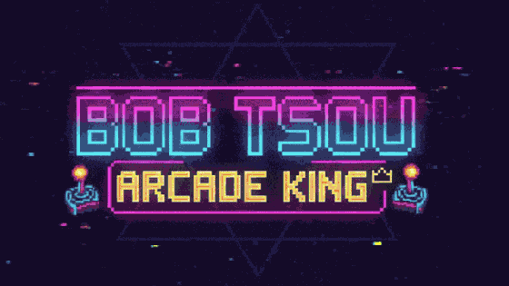
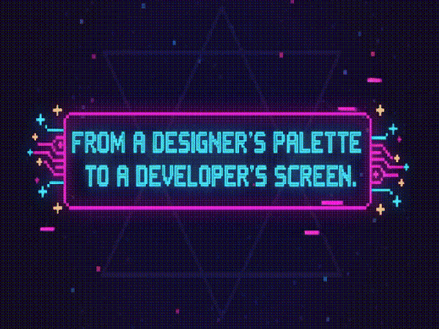
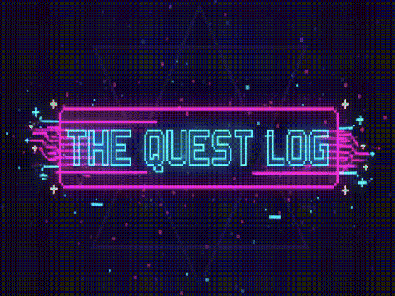

<h1 align="center">
  
</h1>

  <h3 align="center">👨‍💻 About Me — My Origin Story / 關於我</h3>
  

    實戰型 AI 應用工程師，具備約 6 年電商設計與行銷經驗，專攻中小企業 AI 工作流落地、防幻覺評測與內部自動化。現職主責服務 2,100+ 所學校的學習平台前端（Vue 3，並參與 .NET 8 後端整合），並在 2026/07 起一人從頭重建公司的地端 AI 內容產線：原本每月約 200 美元的雲端模型訂閱改為公司自有主機，國考試題自動轉題庫讓編輯免手打。我負責架構、規則、驗收與上線決策，開發大量使用 AI coding agent。
  

  

    
🇬🇧 English Version

    <i>
An applied AI engineer with about 6 years in e-commerce design and marketing, focused on bringing AI workflows into small and mid-sized companies, hallucination-proof evaluation, and internal automation. I own the frontend of a learning platform serving 2,100+ schools (Vue 3, with .NET 8 backend integration), and since 2026/07 I have rebuilt the company's on-premise AI content pipeline on my own: a ~US$200/month cloud model subscription moved to the company's own hardware, and exam questions are converted into question banks automatically so editors no longer retype them. I own the architecture, rules, acceptance and release decisions, and build heavily with AI coding agents.
</i>
  

   
  

---

<h3 align="center">🕹️ My Skill Stack — Character Abilities / 我的技能</h3>
<table width="100%" align="center">
  <tr>
    <td align="center">
      <strong>Frontend</strong> 
      
    </td>
    <td align="center">
      <strong>Backend</strong> 
      
    </td>
  </tr>
  <tr>
    <td align="center">
      <strong>Design</strong> 
      
    </td>
    <td align="center">
      <strong>Tools</strong> 
      
    </td>
  </tr>
</table>

  

---

<h3 align="center">🚀 My Featured Projects — The Quest Log / 我的精選專案</h3>

  

 

<table width="100%">
  <tr>
    <td width="50%" valign="top">
      

        <h4>🖥️ Interactive Portfolio & CMS</h4>
        
一個整合前後端的互動式作品集，具備流暢的 UI 動畫與後台管理系統；以 Docker 部署在自架 NAS，push 後由 GitHub Actions 打包、自動上線。

        

          
🇬🇧 English Version

          <i>
An interactive full-stack portfolio with smooth UI animations and a CMS, self-hosted with Docker on a NAS and auto-deployed by GitHub Actions on every push.
</i>
        

         
        
<strong>Tech Stack:</strong> <code>Vue 3</code> <code>TypeScript</code> <code>GSAP</code> <code>Three.js</code> <code>Laravel</code> <code>MySQL</code> <code>Docker</code>

        
        
      

    </td>
    <td width="50%" valign="top">
      

        <h4>🕹️ 心情日曆-AI情緒日記</h4>
        
AI 智慧圖文生成：深度整合多個生成式 AI 服務，使用者只需輸入日記內容，系統即可自動生成符合情境的 AI 插畫與心情短語。

        

          
🇬🇧 English Version

          <i>
An AI mood diary: write a few lines about your day, and the app generates a matching illustration and a short mood phrase with generative AI.
</i>
        

         
        
<strong>Tech Stack:</strong> <code>PHP (MVC)</code> <code>MySQL</code> <code>JavaScript</code> <code>Replicate · Imagen 4</code> <code>Docker</code>

        
        
      

    </td>
  </tr>
  <tr>
    <td width="50%" valign="top">
      

        <h4>🍱 食在輔大</h4>
        
輔大心園餐廳介紹網站：店家、菜單與位置一頁看完，手機優先的 RWD 設計，已上線。

        

          
🇬🇧 English Version

          <i>
A mobile-first guide to the Xinyuan cafeteria at Fu Jen Catholic University: vendors, menus and locations on one page. Live.
</i>
        

         
        
<strong>Tech Stack:</strong> <code>React</code> <code>TypeScript</code> <code>Vite</code>

        
        
      

    </td>
    <td width="50%" valign="top">
      

        <h4>🏀 泰山投籃機</h4>
        
以夜市投籃機為靈感的網頁小遊戲，計時、計分與投籃動畫全部用原生 JavaScript 完成。

        
<strong>Tech Stack:</strong> <code>HTML5</code> <code>CSS3</code> <code>JavaScript</code>

        
        
      

    </td>
    <td width="50%" valign="top">
      

        <h4>🥋 雙人格鬥遊戲</h4>
        
Ken 對 Ryu 的雙人同機對戰，有血量、跳躍、波動拳與 CRT 掃描線特效。

        
<strong>Tech Stack:</strong> <code>HTML5</code> <code>CSS3</code> <code>JavaScript</code>

        
        
      

    </td>
  </tr>
</table>

---

<h3 align="center">🏆 My GitHub Stats — Player Data / GitHub 數據</h3>

   
  

---

<h3 align="center">📬 Let's Connect! — Join the Party / 聯絡我</h3>

  
  

 
